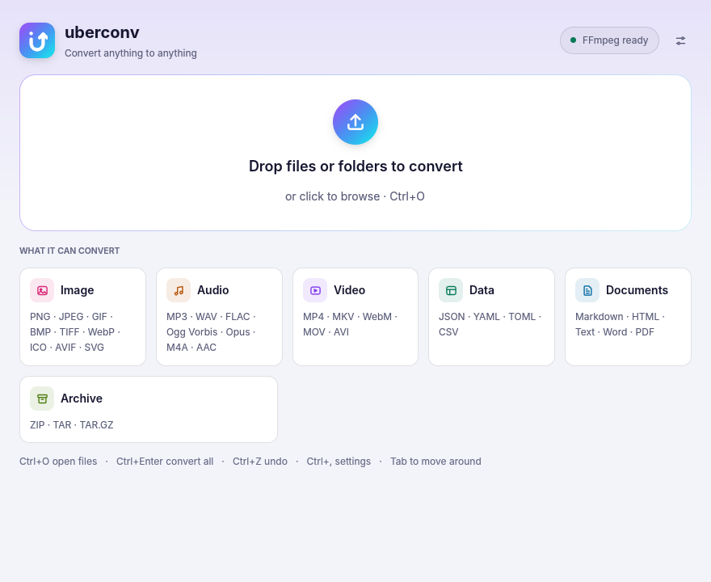
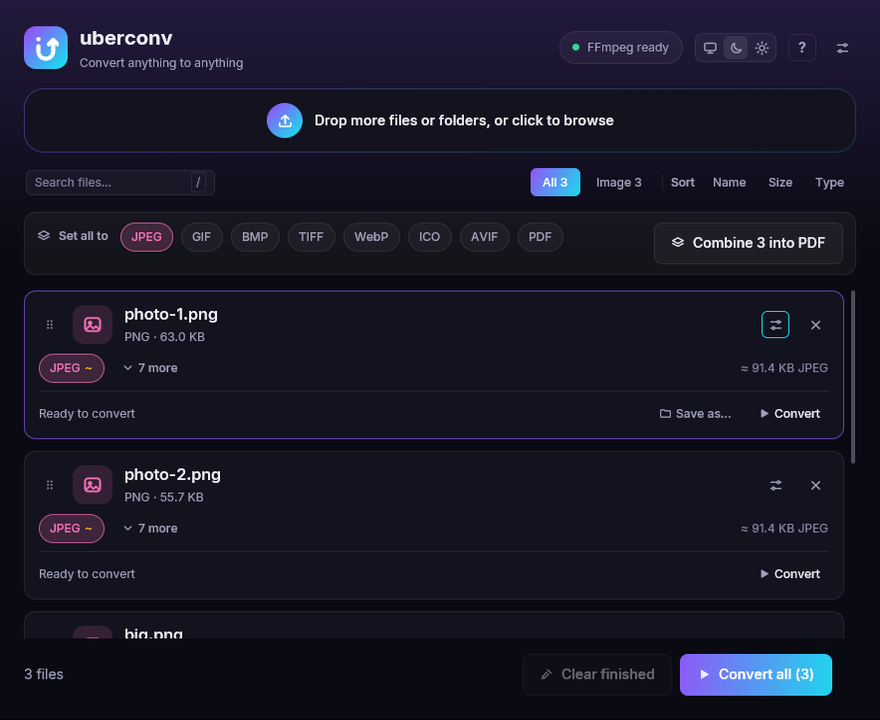
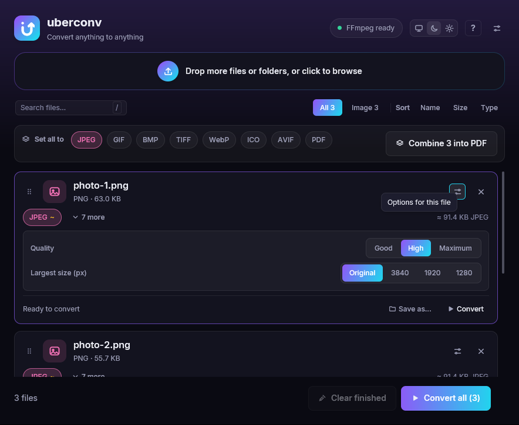
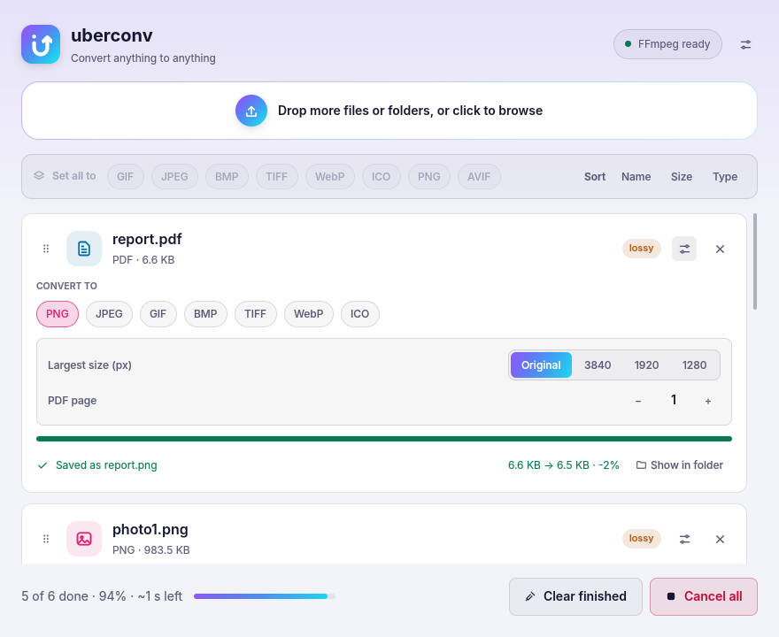
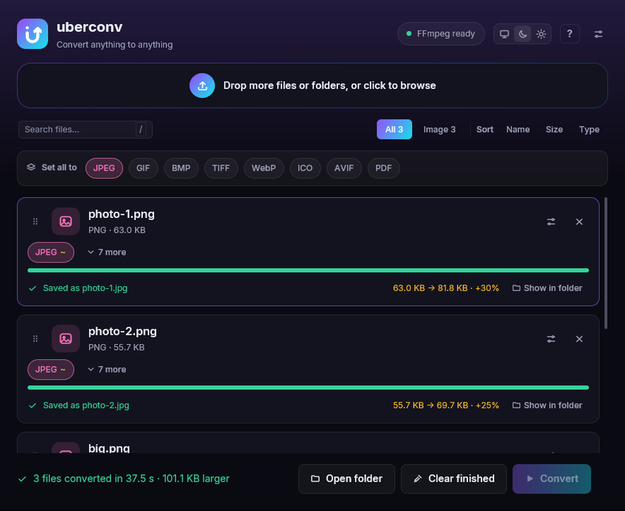
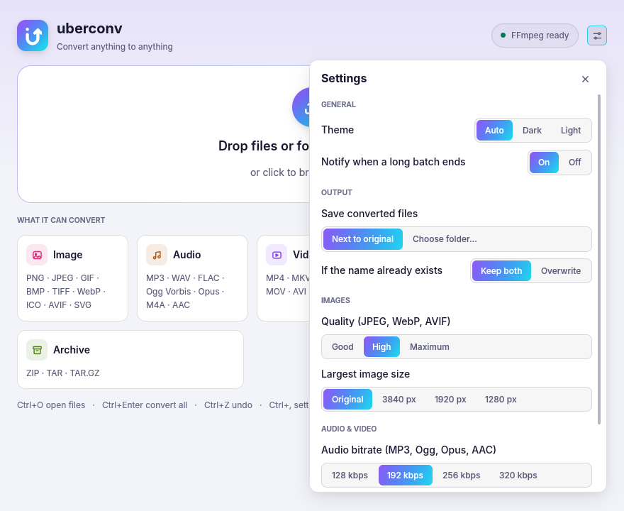

<p align="center"></p>

# uberconv

A file converter in Rust with a GPUI desktop UI and a CLI. Images, audio,
video, data files and text documents, with FFmpeg bundled as a sidecar.

```
assets/logo/        logo: SVG sources, PNGs (16-1024px) and uberconv.ico
crates/
  uberconv-core/     Format, Converter trait, conversion graph + planner
  uberconv-formats/  built-in converters (image, data, text, ffmpeg)
  uberconv-cli/      `uberconv` command line tool
  uberconv-app/      GPUI desktop app
scripts/fetch-ffmpeg.sh
```

## Screenshots

| Empty state | Mixed queue | Per-file options |
|---|---|---|
|  |  |  |

| Converting (ETA) | Finished | Settings |
|---|---|---|
|  |  |  |

(Captured from the real GPUI app under a virtual display, so there is no
window title bar.)

## Logo & design

The mark is a U-turn arrow that starts at a dot: a "u" for uberconv, and
"from here to there". Source files live in `assets/logo/`
(`uberconv-icon.svg`, `uberconv-glyph.svg`, PNGs and `uberconv.ico` for app
bundles). Palette: violet `#8b5cf6` -> cyan `#22d3ee` on near-black `#0a0a12`,
with a colour per media family (image pink, audio amber, video violet, data
green, text sky).

The app uses the same tokens (`crates/uberconv-app/src/theme.rs`), in a dark and
a light palette that follows the system (or can be forced in Settings). All text
meets WCAG AA contrast. Inter is bundled (SIL OFL, see
`crates/uberconv-app/assets/fonts/Inter-LICENSE.txt`) so weights and spacing look
the same everywhere.

**What the app does**

* Drop files **or folders** (folders are walked; hidden files and unsupported types
  are skipped and reported). Files can also be passed on the command line /
  "Open with".
* **Set all to...** bar to convert a whole queue to one format at once.
* Per-file format chips grouped by family, with tooltips showing the route
  (`PNG -> JPEG (lossy)`), plus `lossy` and `via JSON` tags that explain themselves.
* Honest states: *Queued*, *Converting 42%*, *Cancelling...*, *Done* (with
  `3.3 MB -> 512 KB, -85%`), *Failed* (expandable details, Copy, Retry) and a
  neutral *Cancelled*. Cancel one file or everything; retry any file.
* Overall progress in the footer, a result summary when a batch ends
  ("12 files converted in 8.3 s, saved 24 MB"), and an optional desktop
  notification for long batches (Linux `notify-send`, macOS `osascript`).
* **Settings** (persisted as JSON in the platform config dir): theme, output
  folder, overwrite vs. keep both, JPEG quality, largest image size, audio
  bitrate, video quality, notifications. The window size is remembered.
* Keyboard: `Ctrl/Cmd+O` open, `Ctrl/Cmd+Enter` convert, `Ctrl/Cmd+.` cancel all,
  `Ctrl/Cmd+K` clear finished, `Ctrl/Cmd+Z` undo, `Ctrl/Cmd+,` settings, `Esc` close settings,
  `Tab`/`Shift+Tab` to move focus (focus rings on every control).
* **Virtualised queue**: only the visible rows are built, so thousands of files
  stay smooth (measured: 3,006 queued files, at most 6 rows built per frame
  while scrolling; set `UBERCONV_DEBUG_ROWS=1` to see it).
* **Per-file options** (the sliders icon on a card): quality, largest size,
  audio bitrate, video quality and the **PDF page**, showing only what matters
  for that file's target. A "custom" tag marks files that differ from Settings.
* **Undo** removals and "Clear finished" (toast button or `Ctrl/Cmd+Z`),
  **drag to reorder** (grip on each card) and **sort** by name, size or type.
* **ETA** in the footer ("5 of 6 done · 99% · ~1 s left").
* Thin custom scrollbars for the queue and the settings panel.

Icons are small embedded SVGs in `crates/uberconv-app/assets/icons/`.

## How it works

Converters don't implement format *pairs*; they declare **edges**
(`from -> to`, with a cost and a lossy flag). The registry runs Dijkstra over
those edges, so one new converter connects its formats to everything already
reachable. `YAML -> CSV` isn't written anywhere: it's planned as
`YAML -> JSON -> CSV`, with intermediate files in a temp dir and progress
stitched into one bar.

* Lossy steps carry a penalty, so lossless routes win when one exists.
* A step that changes media family (video -> GIF) is only allowed as one
  direct step, which stops silly routes like `MP4 -> GIF -> PNG`.
* Conversions are cancellable; cancelled or failed runs don't leave partial
  output behind.

| Family | Formats | Backend |
|---|---|---|
| Image | PNG, JPEG, GIF, BMP, TIFF, WebP, ICO; **SVG** and **HEIC** (input only); **AVIF** | `image` + libwebp (WebP is lossy, or lossless at quality 100); `resvg` for SVG; libheif or Windows' HEIF codec for HEIC; FFmpeg for AVIF |
| Audio | MP3, WAV, FLAC, Ogg Vorbis, Opus, M4A, AAC | FFmpeg |
| Video | MP4, MKV, WebM, MOV, AVI, plus video -> GIF and GIF -> MP4/WebM | FFmpeg |
| Data | JSON, YAML, TOML, CSV | serde + csv (JSON is the hub; JSON <-> YAML streams) |
| Documents | Markdown, HTML, plain text, **Word (.docx)**, **PDF** | pulldown-cmark; own DOCX reader/writer; `hayro` (PDF render) + a small PDF writer |
| Archive | **ZIP, TAR, TAR.GZ** | `zip`, `tar`, `flate2` (streamed repack, no extraction) |

Details worth knowing:

* **Photos**: EXIF orientation is applied, so phone pictures aren't sideways.
  Other metadata (EXIF, ICC profiles) is *not* copied to the output.
* **SVG** is rasterised (1024 px on the long side unless you set a size).
* **PDF -> image** renders one page per conversion (page 1, or the page you pick
  in the file's options / `--page N`) at 150 dpi on white. **Image -> PDF**
  makes a one-page PDF sized to the image; JPEGs are embedded untouched, PNG
  transparency becomes a soft mask. Encrypted PDFs aren't supported.
* **Word** conversion keeps structure (headings, bold/italic/strike, code,
  links, nested lists, tables, quotes), not layout; images, comments and
  headers/footers are dropped. Word -> HTML/text and text -> Word go through
  Markdown automatically.
* **Archives** keep permissions, timestamps and symlinks. Entries with absolute
  paths or `..` are rejected.
* **AVIF** needs an FFmpeg build with libaom (encode) and dav1d (decode), which
  the static builds from `scripts/fetch-ffmpeg.sh` include. Alpha is not kept.
* **HEIC** is input only (we read it, we don't write it). Two ways in, tried in
  that order: a bundled **libheif** when `UBERCONV_LIBHEIF_DIR` points at an
  install prefix at build time (`include/libheif/heif.h` plus `heif.lib` /
  `libheif.a`), otherwise the **Windows Imaging Component** codec, which is
  what Microsoft's free "HEIF Image Extensions" (plus the HEVC extension, for
  HEVC-coded photos) provides — so Windows builds read HEIC with nothing to
  bundle. Rotation carried by the container is applied by the decoder.
* Not supported: RAW photos, 7z/RAR.

## Build

Needs a recent stable Rust: **1.92 or newer** (hayro 0.9 declares that). I
developed on 1.91 with `cargo ... --ignore-rust-version`, which compiled fine, but
1.92+ is the supported route.

```sh
cargo test                       # core + formats + CLI
cargo run -p uberconv-cli -- --help
cargo run -p uberconv-app        # the GPUI app
cargo run -p uberconv-app -- a.png b.mp4   # ...with files pre-queued
```

GPUI also needs platform libraries (Vulkan/Wayland/X11 dev packages on Linux,
Xcode + Metal toolchain on macOS). See the GPUI / Zed build docs.

### CLI

```sh
uberconv photo.png photo.webp
uberconv *.png --to jpg -q 85 --max-size 1600
uberconv talk.mp4 --to mp3 --bitrate 256
uberconv config.yaml config.toml
uberconv report.pdf page.png --page 3   # render page 3
uberconv photo.png photo.pdf
uberconv notes.md notes.docx
uberconv backup.zip backup.tar.gz
uberconv targets yaml            # what can YAML become, and via which route?
```

## Performance

Measured with release builds in a **single-core** sandbox (so batch
parallelism isn't visible in these numbers):

| Job | Time |
|---|---|
| 12 MP PNG -> JPEG / WebP / BMP / TIFF / ICO | 0.3 - 0.8 s |
| 12 MP PNG -> GIF | ~4 s (was 14 s before lowering the quantiser effort) |
| 27 MB JSON (200k records) -> YAML / CSV | 1.1 s / 0.7 s |
| 5 min WAV -> MP3 (FFmpeg) | 2.7 s (raw `ffmpeg`: 2.5 s) |
| 1 s WAV -> MP3, per-file overhead | 55 ms (raw `ffmpeg`: 52 ms) |
| 200 small PNGs -> WebP, one command | 1.8 s |
| 27 MB JSON -> YAML, peak memory | 118 MB streaming (was ~350 MB through an in-memory tree; JSON -> CSV still uses ~350 MB) |

Design choices that matter for speed:

* Batches (`convert_batch`, used by both the CLI and the app) run in-process
  conversions in parallel on all cores and FFmpeg jobs one at a time, since
  FFmpeg is already multi-threaded.
* FFmpeg runs as a child process and its duration is read from its own log, so
  there is no separate probe process per file.
* Multi-step routes go through temp files; they aren't streamed.

Known limits: TOML and CSV (and YAML input) are still parsed into memory
(about 13x the file size), and video encoding uses x264 `medium` (tune
`ffmpeg.rs::output_args` for speed vs. size). JSON -> YAML is streamed but
still uses ~4x the file size, not constant memory.

## Bundling FFmpeg

FFmpeg is used as a sidecar executable. At startup the app looks for it in:

1. `$UBERCONV_FFMPEG`
2. next to the executable: `./ffmpeg`, `./binaries/ffmpeg`
3. `../Resources/` (macOS `.app` bundle) and `../lib/uberconv/` (Linux packages)
4. `$PATH`

`scripts/fetch-ffmpeg.sh` downloads a static build into `./binaries/`. Ship
that file next to your installer's executable (or inside `Resources/` on
macOS). If FFmpeg isn't found, audio/video are simply not registered, and
the UI shows a notice.

**Licensing:** the static builds the script fetches are GPL (they include
libx264). Distributing them means complying with the GPL. For a more
permissive distribution use an LGPL FFmpeg build and swap the H.264 encoder
for another (the encoder choices live in `ffmpeg.rs::output_args`).

## Adding a converter

```rust
struct MyConverter;
impl Converter for MyConverter {
    fn name(&self) -> &'static str { "my-converter" }
    fn edges(&self) -> Vec<Edge> {
        vec![Edge::new(Format::Foo, Format::Png, Cost::lossy(30))]
    }
    fn convert(&self, job: &Job<'_>, ctx: &Context) -> Result<()> {
        ctx.report(0.5);
        ctx.cancel.check()?;
        /* read job.input, write job.output */
        Ok(())
    }
}
// registry.register(Box::new(MyConverter));
```

New formats are one line in the `formats!` table in `uberconv-core/src/format.rs`.

## Status

* All crates build and **46 tests pass** (engine, every converter, the CLI, and
  the app's file/settings logic). Fixtures for EXIF, PDF, Word and archives were
  made by independent tools (PIL, python-docx, Python's zipfile/tarfile; see
  `crates/uberconv-formats/tests/fixtures/make_fixtures.py`), and outputs were
  also checked with poppler, pypdf, python-docx, `zipfile`/`tarfile` and
  `ffprobe`. The HEIC test decodes libheif's own sample and checks the size and
  that the pixels aren't blank.
* Exercised on real hardware (Windows 11): native file dialogs opening at the
  remembered folder, a conversion run from the GUI (the output file lands on
  disk), live light/dark switching, the settings overlay, per-file options,
  Ctrl+O / Ctrl+Enter / Ctrl+, / Esc, and the CLI end-to-end
  (`uberconv photo.heic out.png` -> 1280x854, and `out.jpg`).
* The virtual-display pass covered the rest of the queue behaviour: queueing
  folders, 3,000-file queues, per-file options (incl. the PDF page), undo,
  drag-reorder, sorting, cancel, retry, ETA, both themes.
* **Still untested**: real drag-and-drop from a file manager, "Show in folder",
  the desktop notification toast, Ctrl+Z/Ctrl+K, and a 3,000-file queue on real
  hardware.
* GPUI 0.2.2 publishes **no accessibility tree** — a UI Automation capture of
  the running app returns zero elements — so screen readers get nothing. That
  needs an upstream GPUI (or fork) change, not app code.
* File pickers now go through `rfd` rather than GPUI's own, because only `rfd`
  can be given a start folder; that is what makes "remember the last folder"
  possible.
* On Linux, GPUI 0.2.x pulls in `xattr 0.2.3`, which doesn't compile against
  current `libc`. `vendor/xattr` is that crate with a one-line fix, wired in via
  `[patch.crates-io]` (see `vendor/README.md`).

## Ideas for next

Metadata copying (EXIF/ICC), all pages of a PDF at once, PDF text extraction,
7z/xz/bz2 archives, RAW photos, a plugin system (WASM/dylib), per-format presets,
and replacing the FFmpeg sidecar with linked libav* if you want a single binary.
